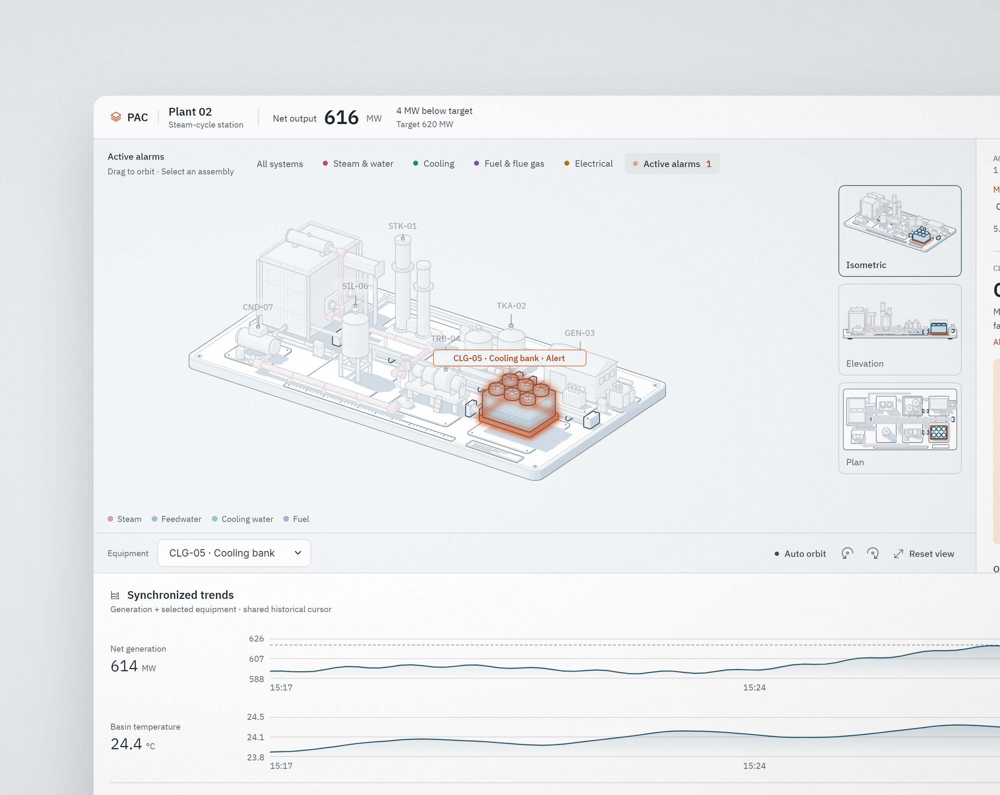

# PAC Control Console



An operator console for a simulated steam-cycle power plant, built with [Uno Platform](https://platform.uno). It takes an alarm from start to finish on one screen.

- **The plant**: an inked isometric drawing of seven units, rendered with SkiaSharp, with isometric, elevation and plan views. Each process system, and every unit in alarm, can be isolated.
- **Alarms**: acknowledge, shelve, and the response for each alarm (likely cause, steps, consequence).
- **Control**: per-unit faceplates. Every command is selected, then confirmed.
- **Trends**: synchronized trends with a shared cursor.
- **Log**: an operator log of every step.
- **Themes**: System, Light or Graphite from the … menu. The choice is kept between launches.

## Run it

Requires the .NET 10 SDK. The app has five heads: desktop (Skia on Windows, macOS and Linux), WebAssembly, Android, iOS and WinAppSDK. It is designed for a 1440×900 window.

```powershell
dotnet run --project PacConsole -f net10.0-desktop -p:PacTargetFrameworks=net10.0-desktop
dotnet run --project PacConsole -f net10.0-browserwasm -p:PacTargetFrameworks=net10.0-browserwasm   # wasm-tools workload
```

`-p:PacTargetFrameworks=<tfm>` builds that head alone, so the other heads' workloads are not needed. The WinAppSDK head builds as x64 or ARM64 (the plant's `SKCanvasElement` needs one), and full screen is offered on desktop and WinAppSDK only. CI (`.github/workflows/ci.yml`) runs the tests and builds every head.

Tests: `dotnet test PacConsole.Tests`.

To see the telemetry-fault state and Retry, set `PAC_TELEMETRY_FAULT` in a Debug run. The stream drops once, after that many snapshots:

```powershell
$env:PAC_TELEMETRY_FAULT = "5"; dotnet run --project PacConsole -f net10.0-desktop -p:PacTargetFrameworks=net10.0-desktop
```

## More

- `SPEC-CONSOLE.md` and `SPEC-OPERATIONS.md` describe the console and the alarm-to-resolution workflow. `docs/SPEC-THEME.md` describes the theme.
- `docs/COMPLETENESS.md` is the current completeness verdict, with runtime evidence in `docs/audit/`.
- `media/art/` holds the launch prints. `media/_source/README.md` explains how they were made.
