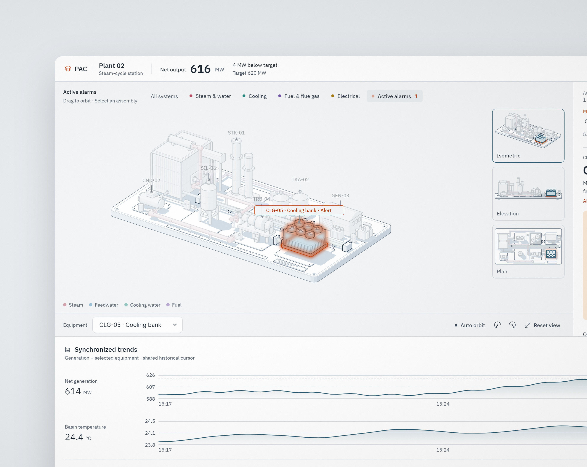

# PAC Control Console

- **Owner:** Matthew Mattei (@noknowscode)
- **Status:** ready for review
- **What it is:** An operator console that takes a simulated power-plant alarm from first alert to resolution on one screen.



An operator console for a simulated steam-cycle power plant, built with [Uno Platform](https://platform.uno). It takes an alarm from start to finish on one screen.

- **The plant**: an inked isometric drawing of seven units, rendered with SkiaSharp, with isometric, elevation and plan views. Each process system, and every unit in alarm, can be isolated.
- **Alarms**: acknowledge, shelve, and the response for each alarm (likely cause, steps, consequence).
- **Control**: per-unit faceplates. Every command is selected, then confirmed.
- **Trends**: synchronized trends with a shared cursor.
- **Log**: an operator log of every step. The log, acknowledgements, shelves, setpoints and the plant mode are kept between launches; the simulated plant carries on while the console is closed.
- **Themes**: System, Light or Graphite from the … menu. The choice is kept between launches.

## Built with

Uno Platform (Uno.Sdk 7.0.5) with MVUX, Uno Navigation Extensions, Uno Toolkit responsive layouts and SkiaSharp in `SKCanvasElement`. The look comes from Uno.Themes: the Simple theme (`SimpleToolkitTheme`), Light and Graphite (Dark).

- **Palette:** one file, `PacConsole/Styles/ColorPaletteOverride.xaml`, read by the theme (`ThemeColors.OverrideSource` in `App.xaml`): all 33 roles in Light and Default, and the file Uno Platform Studio's Themes tab edits. Pages and code use the role brushes the theme generates (`BackgroundBrush`, `SurfaceBrush`, `OnSurfaceBrush`, `OnSurfaceVariantBrush`, `OutlineVariantBrush`, `PrimaryBrush` for the slate-teal selection and the primary action, `ErrorBrush` for errors).
- **Colours with no role** keep their meaning whatever the palette, as an operator console needs: alarms, process states, the select-before-operate highlight, the process systems and pipe circuits, and the plant drawing. They are in `App.xaml`'s Light and Default theme dictionaries. No state is shown by colour alone.
- **Type:** IBM Plex Sans (`DefaultFontFamily`) on the design's closed ramp, 12 / 13 / 16 / 22 / 28, set once in `Styles/TypographyOverride.xaml`; text uses the semantic styles.
- **Spacing, radii, sizes:** the theme's `Space*`, `Radius*CornerRadius`, `ControlHeight*` and `IconSize*` tokens (`DefaultSpacing` 8, `DefaultCornerRadius` 4). `Styles/Layout.xaml` keeps only what no theme has: breakpoints, page frames, the plant and inspector sizes.
- **Code drawing:** the plant, its thumbnails and the trends read the same roles and colours through `Styles/ThemeBrushes.cs` for the console's theme, and redraw on a Light/Graphite switch, a system theme change or a palette edit.

## Run it

Requires the .NET 10 SDK. The app has five heads: desktop (Skia on Windows, macOS and Linux), WebAssembly, Android, iOS and WinAppSDK. It is designed for a 1440×900 window.

```powershell
dotnet run --project PacConsole -f net10.0-desktop -p:PacTargetFrameworks=net10.0-desktop
dotnet run --project PacConsole -f net10.0-browserwasm -p:PacTargetFrameworks=net10.0-browserwasm   # wasm-tools workload
```

`-p:PacTargetFrameworks=<tfm>` builds that head alone, so the other heads' workloads are not needed. The WinAppSDK head builds as x64 or ARM64 (the plant's `SKCanvasElement` needs one), and full screen is offered on desktop and WinAppSDK only. CI (`.github/workflows/ci.yml`) runs the tests, builds every head and launches the Android build on an emulator.

This folder holds the one app project Studio opens. The unit tests (NUnit) live in the development repository, [noknowscode/PAC](https://github.com/noknowscode/PAC).

To start over, delete `operator/operator.json` in the app's local folder (Linux: `~/.local/share/PacConsole/com.unoplatform.pacconsole/LocalState/`).

To see the telemetry-fault state and Retry, set `PAC_TELEMETRY_FAULT` in a Debug run. The stream drops once, after that many snapshots:

```powershell
$env:PAC_TELEMETRY_FAULT = "5"; dotnet run --project PacConsole -f net10.0-desktop -p:PacTargetFrameworks=net10.0-desktop
```

## More

- `SPEC-CONSOLE.md` and `SPEC-OPERATIONS.md` describe the console and the alarm-to-resolution workflow. `docs/SPEC-THEME.md` describes the theme.
- `docs/COMPLETENESS.md` is the current completeness verdict, with runtime evidence in `docs/audit/` and `docs/evidence/`.
- `media/art/` holds the launch prints. `media/_source/README.md` explains how they were made.
